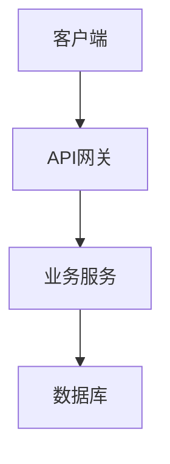
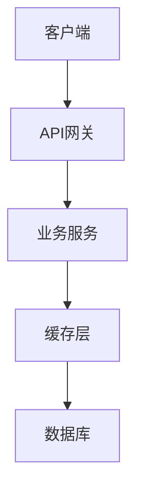
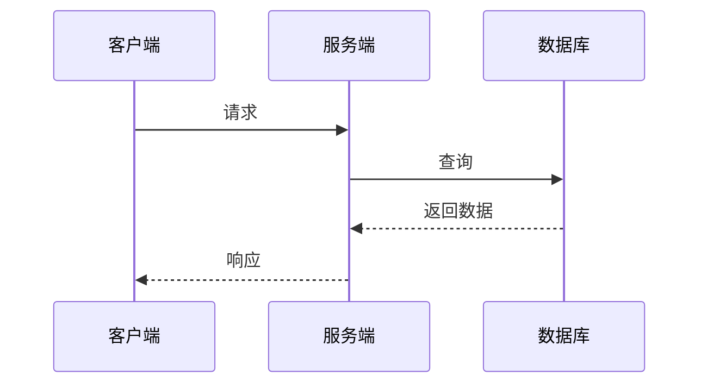

# 技术提案模板

适用于综合技术方案设计，包含架构图、时序图、接口设计、风险评估、实施排期等完整内容。

```markdown
# {方案标题}

- **状态**：Draft | Review | Approved | Rejected
- **版本**：v{X.Y}
- **日期**：{YYYY-MM-DD}
- **作者**：{姓名/团队}
- **评审人**：{评审人列表}

---

## 1. 背景与目标

### 1.1 业务背景

描述当前业务现状、痛点、驱动本次方案的需求来源。

### 1.2 目标

用可量化的指标描述本次方案要达成的目标：
- 目标1：{量化指标，如"接口延迟从200ms降至20ms"}
- 目标2：{量化指标}
- 目标3：{量化指标}

### 1.3 非目标

明确不做的事情，划定边界：
- 非目标1
- 非目标2

---

## 2. 现状分析

### 2.1 现有架构

用 Mermaid 描述当前系统架构：



### 2.2 痛点与问题

| 问题 | 影响 | 严重程度 |
|------|------|---------|
| 问题描述 | 业务/技术影响 | 高/中/低 |

---

## 3. 方案设计

### 3.1 整体架构

用 Mermaid 描述目标架构：



### 3.2 核心流程

用时序图描述关键业务流程：



### 3.3 接口设计

```yaml
# 接口定义
path: /api/v1/resource
method: POST
request:
  field1: type  # 说明
  field2: type  # 说明
response:
  code: int     # 状态码
  data: object  # 业务数据
```

### 3.4 数据模型

| 字段 | 类型 | 说明 | 约束 |
|------|------|------|------|
| id | bigint | 主键 | 自增 |
| name | varchar(128) | 名称 | 非空 |

[EXPAND 详细 DDL]
```sql
CREATE TABLE example (
    id BIGINT PRIMARY KEY AUTO_INCREMENT,
    name VARCHAR(128) NOT NULL,
    created_at DATETIME DEFAULT CURRENT_TIMESTAMP
);
```
[/EXPAND]

---

## 4. 方案对比

| 维度 | 方案A | 方案B | 最终选定 |
|------|-------|-------|---------|
| 性能 | 评估值 | 评估值 | ✅ |
| 成本 | 评估值 | 评估值 | |
| 复杂度 | 评估值 | 评估值 | |
| 运维 | 评估值 | 评估值 | |
| 团队匹配 | 评估值 | 评估值 | |

**选定理由**：综合评估后选择{方案名}，核心原因是{关键决策因素}。

---

## 5. 风险评估

| 风险 | 等级 | 影响 | 应对措施 |
|------|------|------|---------|
| 风险描述 | 高/中/低 | 影响范围 | 缓解方案 |
| 风险描述 | 高/中/低 | 影响范围 | 缓解方案 |
| 风险描述 | 高/中/低 | 影响范围 | 缓解方案 |

---

## 6. 实施计划

### 6.1 里程碑

| 阶段 | 内容 | 时间 | 负责人 | 状态 |
|------|------|------|--------|------|
| 阶段1 | 设计评审 | W1 | @负责人 | [ ] |
| 阶段2 | 开发实现 | W2-W3 | @负责人 | [ ] |
| 阶段3 | 测试验证 | W4 | @负责人 | [ ] |
| 阶段4 | 灰度上线 | W5 | @负责人 | [ ] |
| 阶段5 | 全量发布 | W6 | @负责人 | [ ] |

### 6.2 任务清单

- [ ] 任务1 — @负责人
- [ ] 任务2 — @负责人
- [ ] 任务3 — @负责人

---

## 7. 验收标准

| 验收项 | 指标 | 验证方式 |
|--------|------|---------|
| 性能 | 延迟 < 20ms | 压测报告 |
| 可用性 | SLA 99.9% | 监控面板 |
| 功能 | 全部用例通过 | 测试报告 |

---

## 8. 后续规划

- 短期（1-3月）：{计划}
- 中期（3-6月）：{计划}
- 长期（6-12月）：{计划}

---

## 变更历史

| 日期 | 版本 | 变更内容 | 作者 |
|------|------|---------|------|
| {YYYY-MM-DD} | v1.0 | 创建文档 | {作者} |
```

## 校验清单

- [ ] 背景与目标含可量化指标
- [ ] 至少 1 张架构图（Mermaid flowchart）
- [ ] 至少 1 张时序图（Mermaid sequenceDiagram）
- [ ] 方案对比含对比表格
- [ ] 风险评估含风险等级和应对措施
- [ ] 实施计划含时间线和负责人
- [ ] 验收标准可量化
- [ ] Mermaid 节点标签不含 `(` `)` `|` 字符
