# Mermaid 图表写作规范

产出 `.mmd` 源文件或 Markdown 内嵌 ` ```mermaid ` 代码块时的写作规则、各图表类型语法要点与校验清单。目标：可渲染、明暗主题可移植、屏幕阅读器可读、下游工具（导入重绘、转换器）可再解析。

## 总则

1. **类型优先**：按内容选最具体的图表类型，不要全部塞进 flowchart。服务交互用 sequenceDiagram，生命周期用 stateDiagram，数据模型用 erDiagram。
2. **可访问性**：每图必带 `accTitle` + `accDescr`；不支持的类型在代码块上方放一段斜体 Markdown 描述（见 §1）。
3. **主题中立为默认**：不写 `%%{init}` 主题指令、不写内联 `style`，让宿主自动适配明暗主题。确有着色需求时才按 §3 使用样式指令。
4. **语义命名**：节点 ID 用 `snake_case` 且与标签含义对应（`run_tests`，不是 `A`/`node1`）；标签主动语态、句首大写风格；动作用动词、状态用名词。
5. **样式一致**：同一 emoji = 同一含义，同一形状 = 同一语义，跨同一文档所有图保持一致。
6. **复杂度分级**：1–10 节点平铺；10–20 节点用 subgraph 分 2–4 组；20–30 节点 subgraph 强制（3–6 组）；30+ 节点拆成"总览图 + 分组明细图"多图组合。

## 1 可访问性

支持的类型在首行声明后紧跟：

```
accTitle: 3–8 个词的标题
accDescr: 一到两句话，说明图示内容与读者获得的关键信息，必须单行
```

**不支持 accTitle/accDescr 的类型**：mindmap、timeline、quadrantChart、sankey-beta、xychart-beta、block-beta、kanban、packet-beta、architecture-beta、radar-beta、treemap-beta。这些类型改为在代码块正上方写一段斜体 Markdown 描述段落。

## 2 标签、形状与 emoji

- 节点标签 3–6 词，边标签 1–4 词；复杂度靠结构表达，不靠长标签。
- 加粗只用于每节点 1 个关键词：`[🚀 **Gradual** rollout]`；整标签加粗等于没加粗。
- flowchart 形状语义固定：

| 形状 | 语法 | 语义 |
|---|---|---|
| 圆角矩形 | `([text])` | 开始 / 结束 |
| 矩形 | `[text]` | 处理 / 动作 |
| 菱形 | `{text}` | 判断（每个 subgraph ≤3 个判断） |
| 双边框 | `[[text]]` | 子流程 |
| 圆柱 | `[(text)]` | 数据库 / 存储 |
| 不对称 | `>text]` | 事件 / 外部触发 |
| 六边形 | `{{text}}` | 准备 / 初始化 |

- emoji 规则：每节点最多 1 个、放在标签开头、含义全局一致、不用装饰性 emoji（🎉💯🔥✨）。常用语义集：☁️ 云/平台、🌐 网络/网关、🖥️ 服务器、💾 存储、⚙️ 处理、🔄 循环/重试、🚀 发布、⚡ 触发、📦 制品、👤 用户、🤖 自动化、✅ 成功、❌ 失败、⚠️ 风险、🔐 安全、📊 指标、📥 输入、📤 输出、🏁 里程碑。
- subgraph 规则：标题带引号和 emoji（`subgraph build ["📦 Build"]`）；每组 2–6 节点；嵌套最多 1 层；总览受众连 subgraph 到 subgraph，工程受众连内部节点到内部节点。
- 每图只保留一个主方向：层级/流程用 `TB`，管线/时间用 `LR`；混用方向会让读者困惑。

## 3 主题与样式指令

默认不写任何主题/样式指令。确需着色（多角色、严重级别）时按以下优先级：形状 + emoji > `classDef` > 其他。

**init 指令**（必须是代码块第一行）：

```
%%{init: {"theme":"neutral","themeVariables":{"primaryColor":"#dbeafe"},"flowchart":{"curve":"linear"}}}%%
```

- theme 取值：`default` / `neutral` / `dark` / `forest` / `base`；`themeVariables` 仅在 `base` 下完全生效。
- 嵌入他人文档/仓库时不写 init 主题，让宿主主题接管；独立交付深色场景才显式指定。

**classDef + class**（首选着色方式）：

```
classDef success fill:#dcfce7,stroke:#16a34a,stroke-width:2px,color:#14532d
class node_a,node_b success
node_c:::success
```

**语义调色板**（明暗双主题验证过，每图最多 3–4 个类）：

| 语义 | classDef 值 |
|---|---|
| 主流程/动作 | `fill:#dbeafe,stroke:#2563eb,stroke-width:2px,color:#1e3a5f` |
| 成功/正常 | `fill:#dcfce7,stroke:#16a34a,stroke-width:2px,color:#14532d` |
| 警告/注意 | `fill:#fef9c3,stroke:#ca8a04,stroke-width:2px,color:#713f12` |
| 危险/故障 | `fill:#fee2e2,stroke:#dc2626,stroke-width:2px,color:#7f1d1d` |
| 中性/信息 | `fill:#f3f4f6,stroke:#6b7280,stroke-width:2px,color:#1f2937` |
| 强调/高亮 | `fill:#ede9fe,stroke:#7c3aed,stroke-width:2px,color:#3b0764` |
| 商业/暖色 | `fill:#ffedd5,stroke:#ea580c,stroke-width:2px,color:#7c2d12` |

硬规则：每个 classDef 必带 `color:`（文字色），否则深色背景下文字不可见；禁止内联 `style Node fill:...`；禁止只靠颜色传义（必须搭配形状、emoji 或文字）；`linkStyle 0 stroke:#2563eb` 按边序号着色，仅用于强调单条关键边。

## 4 图表类型：语法要点与最小示例

### 4.1 flowchart / graph

流程、决策逻辑、排障树。`TB` 用于流程，`LR` 用于管线。判断分支必须带边标签。

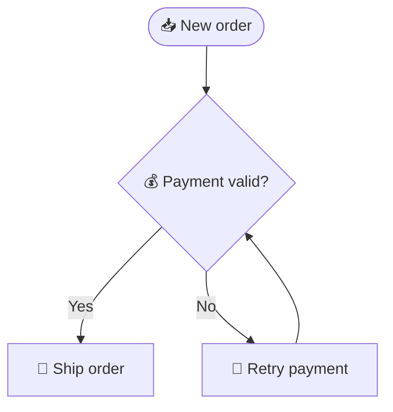

### 4.2 sequenceDiagram

参与者间时序交互。参与者 ≤5 个；实箭头 `->>` 请求、虚箭头 `-->>` 响应；`alt/else/end` 条件、`loop/end` 循环、`par/and/end` 并行、`Note over A,B:` 注释、`box ... end` 分层分组，全部必须成对闭合。

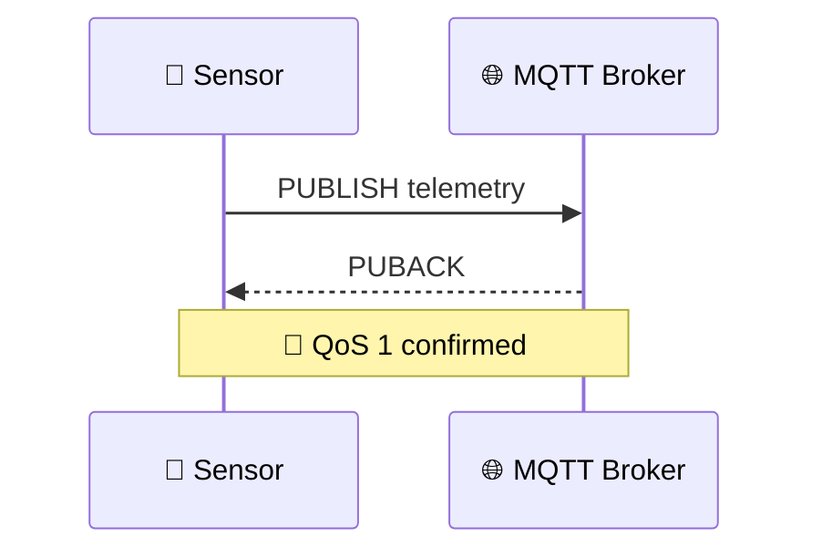

### 4.3 classDiagram

类型层级、接口契约。可见性 `+` 公有 / `-` 私有 / `#` 受保护；构造型 `<<interface>>` / `<<abstract>>` / `<<enumeration>>`；关系：`<|--` 继承、`<|..` 实现、`*--` 组合、`o--` 聚合、`-->` 依赖、`..>` 使用；泛型用 `~`（`List~string~`）。每图 4–6 个类，更大层级用 `namespace` 分组或拆图。

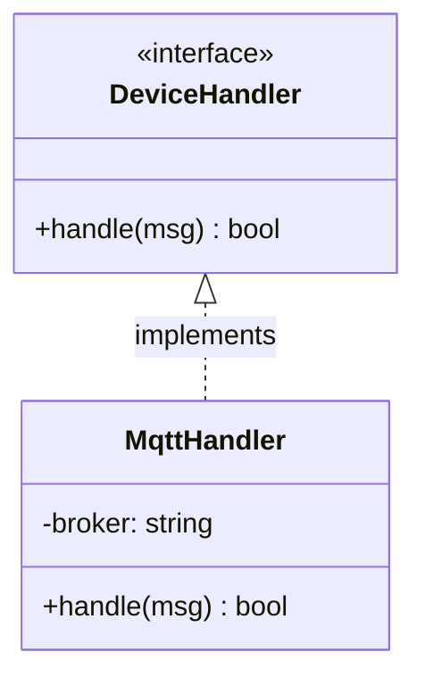

### 4.4 stateDiagram-v2

生命周期、状态机。始终用 `stateDiagram-v2`（旧版 `stateDiagram` 弃用）；`[*]` 表示初始/终止；状态名 CamelCase；`note right of X ... end note` 加注释；复合状态 `state "name" as s1 { ... }` 慎用；≤10 个状态。

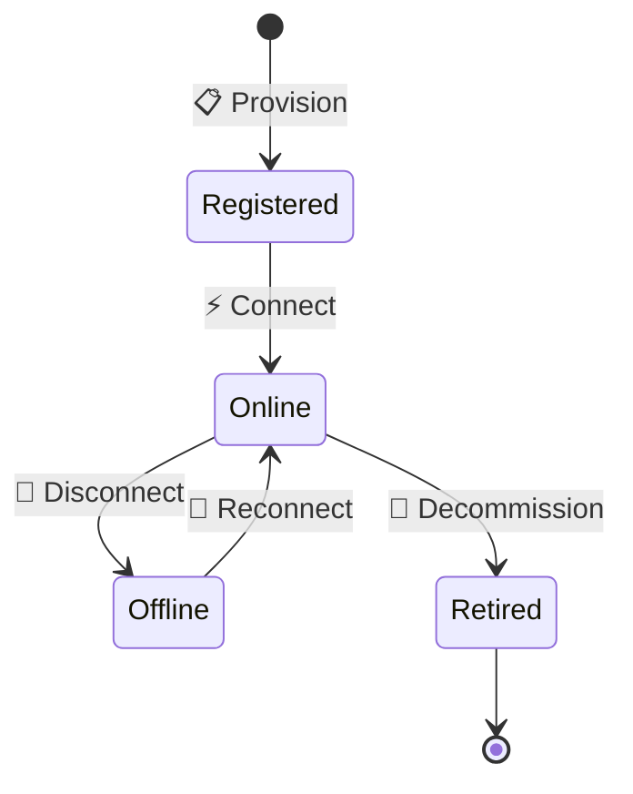

### 4.5 erDiagram

数据库 schema、数据模型。基数记号：`||--o{` 一对多、`||--||` 一对一、`}o--o{` 多对多（`|` 恰好一，`o` 零或多）；关系标签用引号动词短语；属性行 `类型 名称 PK/FK "注释"`；实体名 UPPER_CASE；每图 5–7 个实体，大 schema 按域拆分。

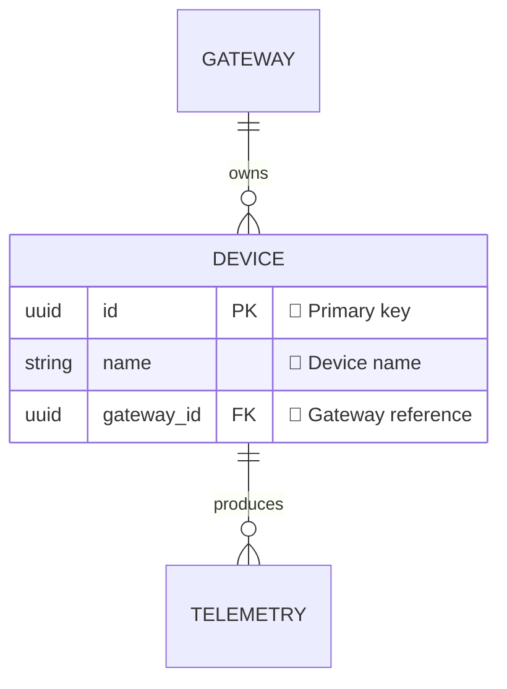

### 4.6 gantt

项目计划、路线图。`dateFormat` 必须与日期值格式一致；`axisFormat` 控制坐标显示（`%b %d`）；`section` 按阶段/团队分组；状态标签 `:done` / `:active` / `:crit`（关键路径）；依赖用 `after taskId`；里程碑 `:milestone` + 时长 `0d`；总时间跨度 ≤3 个月。

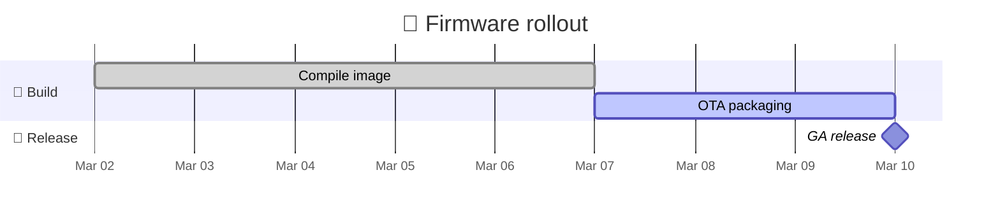

### 4.7 pie

占比构成。值成比例即可、不要求合计 100；标签加引号；≤7 个扇区，尾部合并为 "Other"；按值降序排列；不支持 acc 指令 → 代码块上方写斜体描述段。

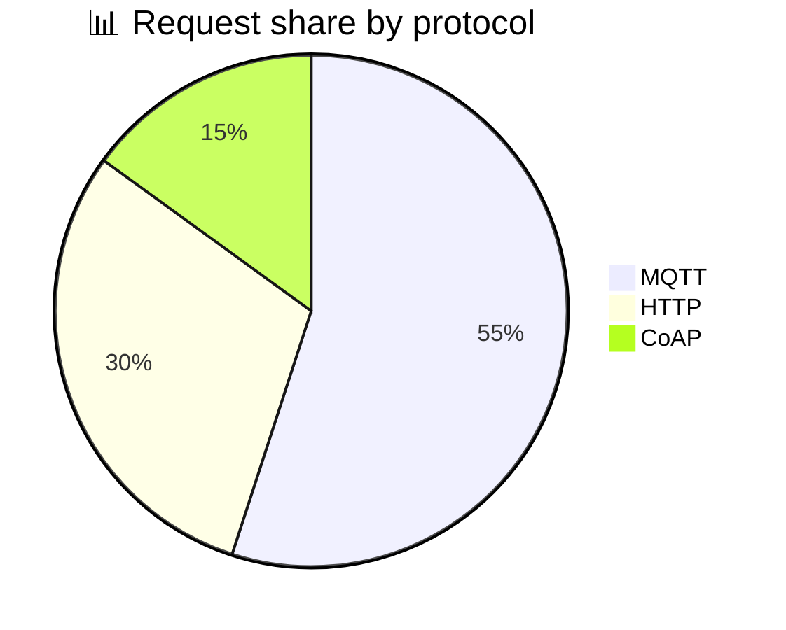

### 4.8 mindmap

概念层级、头脑风暴。层级完全靠缩进表达，同一层缩进必须一致；根节点 `root((text))`；分支可用形状 `[ ]`、`( )`、`(( ))`；3–4 个主分支、每支 3–5 项、嵌套 ≤3 层；不支持 acc 指令 → 斜体描述段。

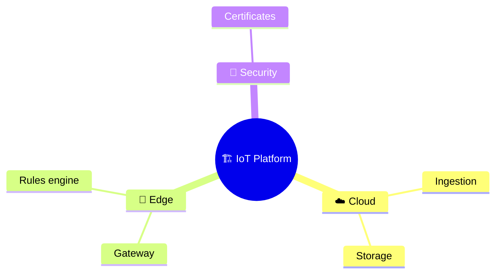

### 4.9 timeline

时间顺序事件、发布史。`section` 按年/季度/阶段分组；同一时间点多个条目用 `:` 分隔；条目 2–4 词；与 gantt 的分工：timeline 只表达先后，不表达时长与依赖；不支持 acc 指令 → 斜体描述段。

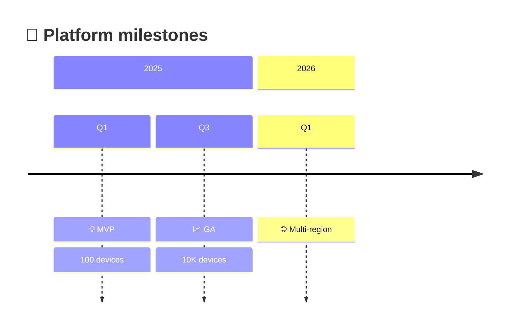

### 4.10 gitGraph

分支策略、合并流程。`commit id: "..."` 描述性标签；`tag:` 标发布版本；`branch` / `checkout` / `merge` 顺序即时间顺序；重要合并用 `type: HIGHLIGHT`；≤15 个 commit；表达"应然"工作流而非流水账。

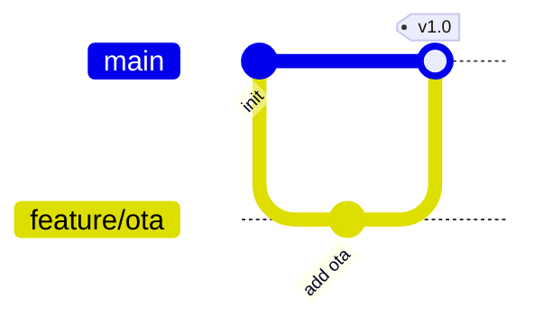

### 4.11 quadrantChart

双轴优先级矩阵。轴标签 `Low X --> High X`；四象限命名用可执行动作（quadrant-1 右上、2 左上、3 左下、4 右下）；条目 `Name: [x, y]`，坐标 0.0–1.0；5–10 个条目；不支持 acc 指令 → 斜体描述段。

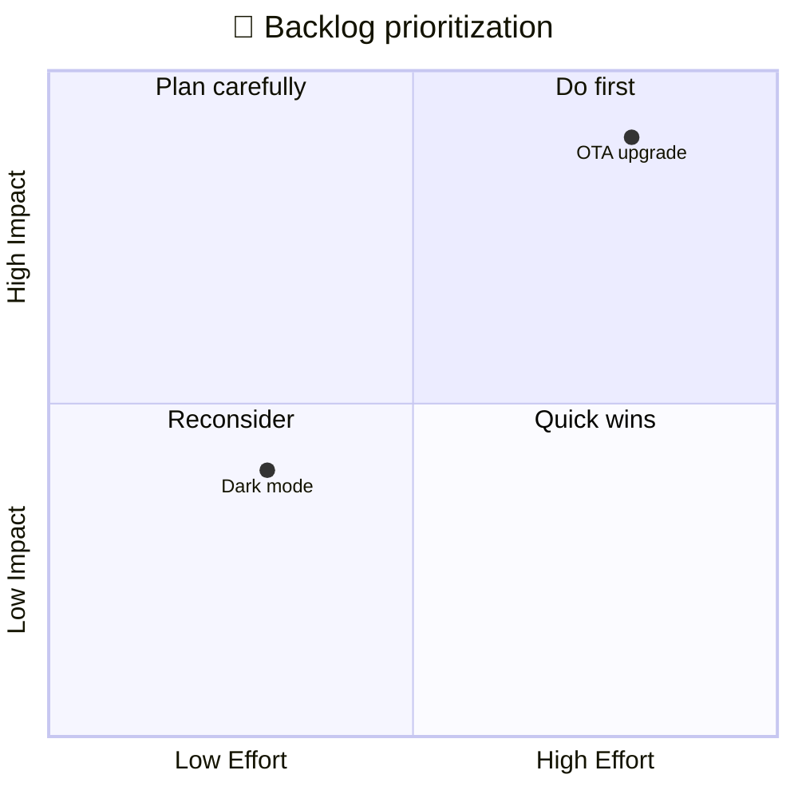

### 4.12 C4Context / C4Container / C4Component

系统架构三级缩放：Context（系统 + 外部角色，面向所有人）、Container（系统内应用/库/队列，面向技术负责人）、Component（容器内模块，面向开发者）。元素：`Person()`、`System()` / `System_Ext()`、`Container()` / `ContainerDb()` / `ContainerQueue()`；关系 `Rel(a, b, "动词", "协议")`；边界 `Container_Boundary(id, "name") { ... }`；标签重叠用 `UpdateRelStyle(a, b, $offsetY="-30", $offsetX="10")` 偏移。描述 ≤4 词；Context 层 ≤5 个元素；不用 emoji（渲染器自带图标）。

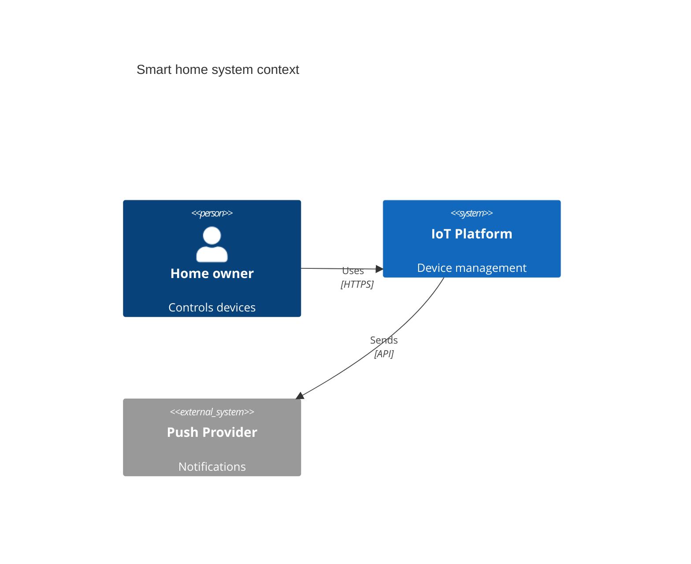

### 4.13 sankey-beta

流量/资源分配量级。每行 `Source,Target,Value`，值决定带宽；层级 ≤3（源 → 类别 → 去向）；组间空行提升可读性；节点名不支持 emoji；不支持 acc 指令 → 斜体描述段。

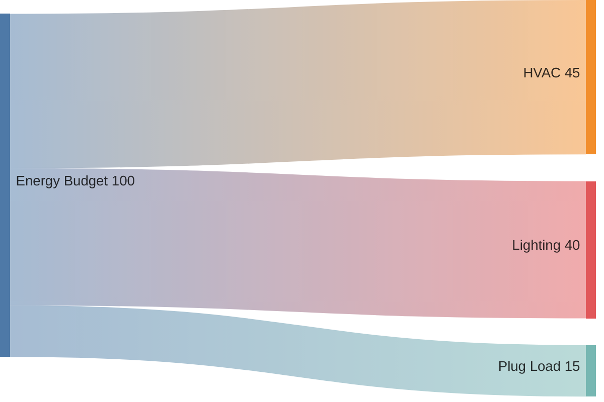

### 4.14 journey

用户体验/满意度地图。步骤行 `名称 : 分数 : 角色1, 角色2`，分数 1（受挫）–5（满意）；`section` 按阶段分组；3–4 个 section、每段 3–4 步；洞察在低分项。

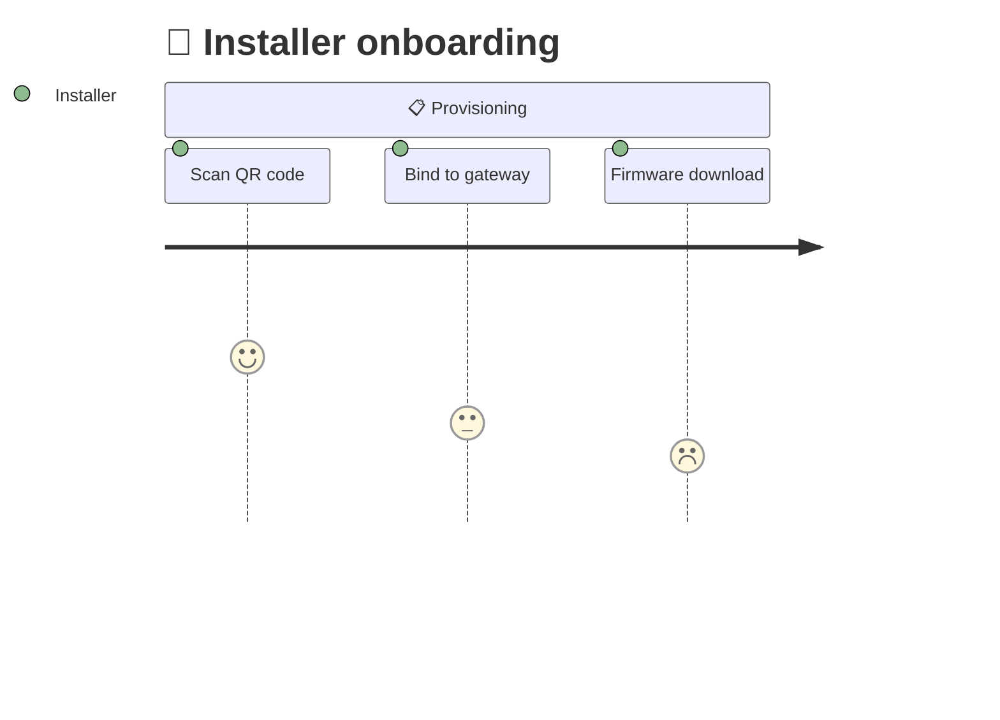

### 4.15 requirementDiagram

需求追溯。requirement 块四字段必填：`id`（**必须纯数字**，`REQ-001` 会解析失败）、`text`、`risk`（low/medium/high，全小写）、`verifymethod`（analysis/inspection/test/demonstration，全小写）；`element` 表示满足需求的组件；关系 `- satisfies ->` / `- traces ->` / `- contains ->` / `- derives ->` / `- refines ->` / `- copies ->`；text 避免特殊字符（写 "99.9 percent" 不写 "99.9%"）；每图 3–5 条需求。

```mermaid
requirementDiagram

    requirement offline_buffer {
        id: 1
        text: Gateway shall buffer 24 hours of telemetry offline
        risk: high
        verifymethod: test
    }
    element edge_runtime {
        type: module
        docref: edge-runtime-v2
    }
    edge_runtime - satisfies -> offline_buffer
```

### 4.16 xychart-beta

数值趋势（柱 + 线）。title 与轴标签加引号；`x-axis [A, B, C]` 类目或 `x-axis 1 --> 10` 数值；`y-axis "单位" min --> max`；`bar [...]` / `line [...]` 可叠加；数据点 6–12 个；不支持 acc 指令 → 斜体描述段。

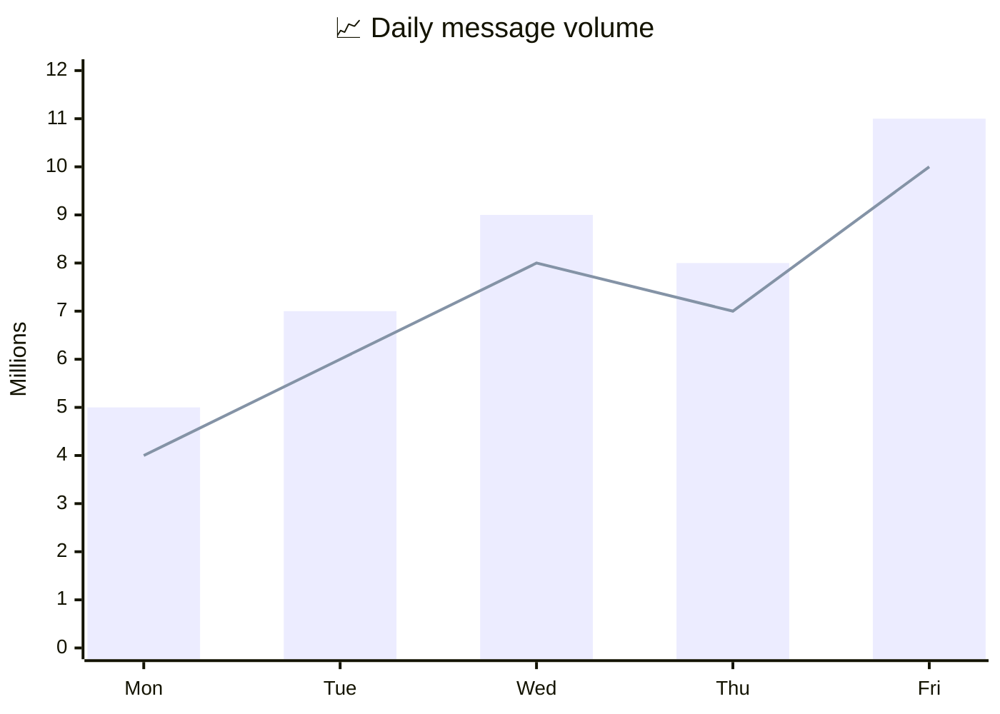

### 4.17 block-beta

空间布局/分层组成。`columns N` 定义网格；`space:N` 占位空格；`block:name:span ... end` 嵌套分组；`-->` 连接；数据库用 `[("text")]`；3–4 行 × 3–4 列为宜；不支持 acc 指令 → 斜体描述段。

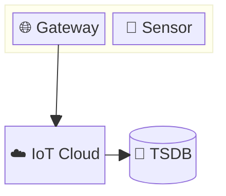

### 4.18 kanban

任务状态板。列名顶格一行，卡片缩进两格 `id[文本]`；3–5 列、每列 3–4 项（代表性而非穷举）；不支持 acc 指令 → 斜体描述段。

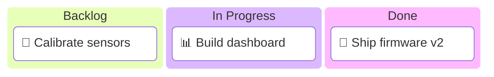

### 4.19 packet-beta

二进制协议/位段格式。每行 `起始位-结束位: "字段名"`，0 起算；默认行宽 32 位自动换行；字段名可缩写；不支持 acc 指令 → 斜体描述段。

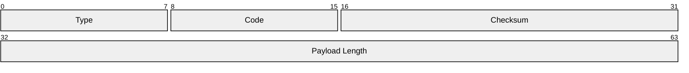

### 4.20 architecture-beta

基础设施拓扑。`group id(icon)[Label]` 定义边界、`in parent` 嵌套；`service id(icon)[Label] in group`；内置图标 `cloud` / `server` / `database` / `internet` / `disk`；连线带方向锚点 `lb:R --> L:api`（R/L/T/B，空格格式严格）；`[]` 标签内禁止 emoji 和连字符（`-` 被解析为边操作符）；6–8 个 service 为宜；不支持 acc 指令 → 斜体描述段。

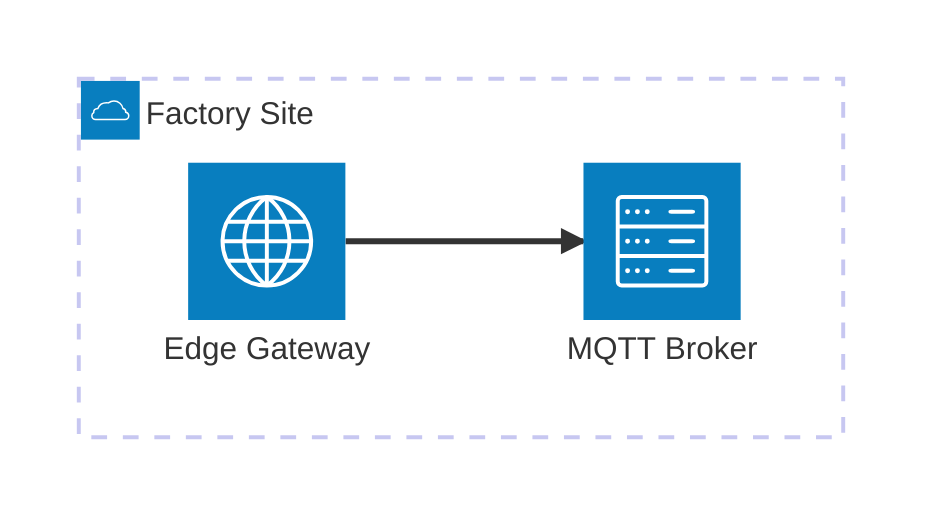

### 4.21 radar-beta

多维对比。需 Mermaid v11.6.0+，先确认目标平台支持；`axis id["Label"], ...` 定义维度（5–8 个）；`curve id["Label"]{v1, v2, ...}` 按 axis 顺序给值（2–4 条曲线）；`max N` 统一量纲；`graticule circle|polygon`、`ticks N`、`showLegend true`；不支持 acc 指令 → 斜体描述段。

```mermaid
radar-beta
    title Protocol comparison
    axis power["Power"], range["Range"], rate["Data rate"], cost["Cost"]
    curve wifi["Wi-Fi"]{2, 3, 5, 4}
    curve lorawan["LoRaWAN"]{5, 5, 2, 3}
    max 5
    showLegend true
```

### 4.22 treemap-beta

层级占比。需 Mermaid v11.12.0+，先确认目标平台支持；父节点 `"Section"` 单独一行，叶节点 `"Leaf": 值`；层级靠缩进；2–3 层为宜；不支持 acc 指令 → 斜体描述段。

```mermaid
treemap-beta
"Fleet Cost"
    "Compute": 45
    "Connectivity": 30
    "Storage": 25
```

### 4.23 zenuml（不推荐）

依赖外部插件，GitHub 等平台不渲染。时序表达一律改用 `sequenceDiagram`。

## 5 常见语法错误与规避

| 类型 | 错误 | 规避 |
|---|---|---|
| flowchart | 节点 ID 用 `end` | 加引号 `["End"]` 或改名 `end_node` |
| flowchart | 标签含 `()`、`--`、`%` 等特殊字符 | 标签整体加引号：`a["MQTT (QoS 1)"]` |
| sequenceDiagram | alt/loop/par/block 未闭合 | 每个块必须以 `end` 收尾，写完后逐块核对 |
| sequenceDiagram | 参与者名含空格 | 用别名：`participant A as 👤 Home owner` |
| classDiagram | 泛型写 `List<string>` | 用波浪号：`List~string~` |
| stateDiagram | 用了旧版 `stateDiagram` | 一律 `stateDiagram-v2` |
| erDiagram | 关系标签不加引号 | 冒号后写 `: "owns"` |
| gantt | 日期与 `dateFormat` 不一致 | 声明 `dateFormat YYYY-MM-DD` 并全图统一 |
| requirementDiagram | `id: REQ-001` 带连字符 | id 只用数字：`id: 1` |
| requirementDiagram | `risk: High` 大写 | risk/verifymethod 全小写 |
| C4 | 描述过长导致标签重叠 | 描述 ≤4 词；用 `UpdateRelStyle()` 偏移 |
| sankey-beta | 节点名带 emoji | 解析器不支持，用纯文本 |
| architecture-beta | `[]` 标签带 emoji 或连字符 | 纯文本；`US East Region` 而非 `US-East` |
| architecture-beta | 箭头锚点空格错误 | 严格 `lb:R --> L:api` 格式 |
| mindmap | 缩进不一致 | 同层缩进相同，只用空格不用 Tab 混排 |
| quadrantChart | 坐标超出 0–1 | 坐标归一化到 0.0–1.0 |
| 通用 | `accDescr` 折行 | 必须单行（GitHub 限制） |
| 通用 | CJK/含空格标签裸写 | 一律加引号 |
| 通用 | radar/treemap 在旧版本渲染失败 | 先确认平台 Mermaid 版本（v11.6.0+ / v11.12.0+） |

## 6 质量校验清单

交付前逐项核对：

- [ ] 类型选择与内容匹配（不是万物 flowchart）
- [ ] `accTitle` + `accDescr` 存在；不支持的类型有斜体描述段
- [ ] 复杂度分级正确：≤10 平铺 / 10–30 subgraph / 30+ 拆图
- [ ] 每个 subgraph ≤3 个判断点；单一主方向（TB 或 LR）
- [ ] ID 语义化 snake_case；节点标签 3–6 词、边标签 1–4 词
- [ ] 特殊字符标签已加引号；块结构（alt/loop/par/subgraph/state）全部闭合
- [ ] 无内联 `style`；着色走 classDef + class，≤4 个色类，每类含 `color:`
- [ ] emoji 每节点 ≤1、置于开头、全文档含义一致
- [ ] 颜色从不单独承载含义（搭配形状/emoji/文字）
- [ ] 在目标平台实际渲染通过（明暗两种主题各看一次）
