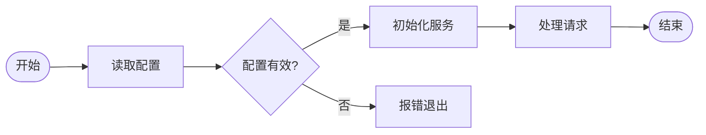
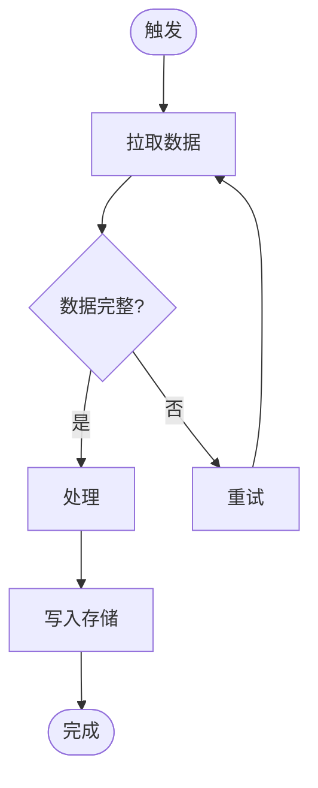
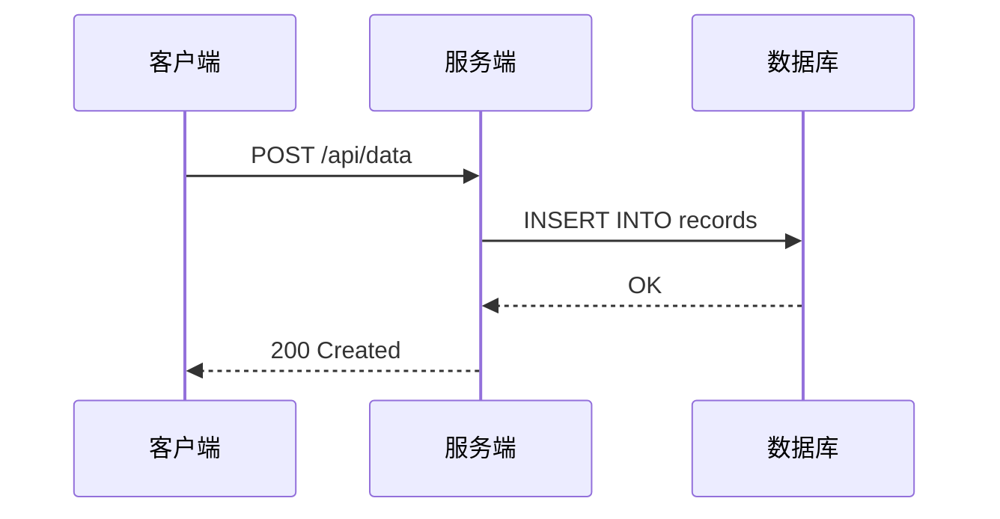

[TOC]

## 1 标题层级

# H1 一级标题（发布时自动剥除，不显示）

## H2 二级标题

### H3 三级标题

#### H4 四级标题

##### H5 五级标题

###### H6 六级标题

---

## 2 段落与内联样式

普通段落文字。行尾两个空格产生硬换行：  
这是硬换行后的内容。

**加粗文字**，*斜体文字*，~~删除线~~，`行内代码`。

组合：**加粗中含 `代码`**，*斜体中含 **加粗***。

---

## 3 列表

### 3.1 无序列表

- 一级项目 A
- 一级项目 B
  - 二级嵌套 B1
  - 二级嵌套 B2
    - 三级嵌套 B2a
- 一级项目 C

### 3.2 有序列表

1. 第一步
2. 第二步
   1. 子步骤 2.1
   2. 子步骤 2.2
3. 第三步

### 3.3 任务列表

- [x] 已完成的任务
- [x] 另一个已完成的任务
- [ ] 待办事项
- [ ] 另一个待办事项

---

## 4 引用块

> 这是一个单行引用。

> 多行引用第一行。
> 第二行继续。
>
> 引用中的新段落。

---

## 5 表格

| 列 A | 列 B | 列 C |
|------|------|------|
| 普通内容 | **加粗单元格** | 123 |
| `代码内容` | *斜体内容* | 456 |
| 较长的单元格内容 | 短 | 789 |

---

## 6 代码块

### 6.1 Python

```python
def fibonacci(n: int) -> int:
    """返回第 n 个斐波那契数（递归实现）。"""
    if n <= 1:
        return n
    return fibonacci(n - 1) + fibonacci(n - 2)

print([fibonacci(i) for i in range(10)])
```

### 6.2 Bash

```bash
#!/bin/bash
for file in *.md; do
    echo "Processing: $file"
    wc -l "$file"
done
```

### 6.3 YAML

```yaml
server:
  host: 0.0.0.0
  port: 8080
  tls:
    enabled: true
    cert: /etc/ssl/cert.pem
```

### 6.4 SQL

```sql
SELECT u.name, COUNT(o.id) AS order_count
FROM users u
LEFT JOIN orders o ON u.id = o.user_id
WHERE u.created_at >= '2024-01-01'
GROUP BY u.id
ORDER BY order_count DESC
LIMIT 10;
```

### 6.5 JSON

```json
{
  "name": "confluence-cli",
  "version": "1.0.0",
  "features": ["markdown", "mermaid", "latex", "expand"],
  "config": {
    "timeout": 30,
    "retry": 3
  }
}
```

### 6.6 自动折叠（超过 200 行自动折叠，此处用 plaintext 模拟长内容）

```plaintext
行 001
行 002
行 003
行 004
行 005
行 006
行 007
行 008
行 009
行 010
行 011
行 012
行 013
行 014
行 015
行 016
行 017
行 018
行 019
行 020
行 021
行 022
行 023
行 024
行 025
行 026
行 027
行 028
行 029
行 030
行 031
行 032
行 033
行 034
行 035
行 036
行 037
行 038
行 039
行 040
行 041
行 042
行 043
行 044
行 045
行 046
行 047
行 048
行 049
行 050
行 051
行 052
行 053
行 054
行 055
行 056
行 057
行 058
行 059
行 060
行 061
行 062
行 063
行 064
行 065
行 066
行 067
行 068
行 069
行 070
行 071
行 072
行 073
行 074
行 075
行 076
行 077
行 078
行 079
行 080
行 081
行 082
行 083
行 084
行 085
行 086
行 087
行 088
行 089
行 090
行 091
行 092
行 093
行 094
行 095
行 096
行 097
行 098
行 099
行 100
行 101
行 102
行 103
行 104
行 105
行 106
行 107
行 108
行 109
行 110
行 111
行 112
行 113
行 114
行 115
行 116
行 117
行 118
行 119
行 120
行 121
行 122
行 123
行 124
行 125
行 126
行 127
行 128
行 129
行 130
行 131
行 132
行 133
行 134
行 135
行 136
行 137
行 138
行 139
行 140
行 141
行 142
行 143
行 144
行 145
行 146
行 147
行 148
行 149
行 150
行 151
行 152
行 153
行 154
行 155
行 156
行 157
行 158
行 159
行 160
行 161
行 162
行 163
行 164
行 165
行 166
行 167
行 168
行 169
行 170
行 171
行 172
行 173
行 174
行 175
行 176
行 177
行 178
行 179
行 180
行 181
行 182
行 183
行 184
行 185
行 186
行 187
行 188
行 189
行 190
行 191
行 192
行 193
行 194
行 195
行 196
行 197
行 198
行 199
行 200
行 201
行 202
行 203
```

---

## 7 LaTeX 数学公式

### 7.1 块公式（$$）

$$
E = mc^2
$$

$$
\int_{-\infty}^{+\infty} e^{-x^2} dx = \sqrt{\pi}
$$

$$
\mathbf{F} = m\mathbf{a} = \frac{d(m\mathbf{v})}{dt}
$$

### 7.2 块公式（\\[ \\]）

\[
\sum_{n=1}^{\infty} \frac{1}{n^2} = \frac{\pi^2}{6}
\]

### 7.3 行内公式

勾股定理：$a^2 + b^2 = c^2$，欧拉公式：$e^{i\pi} + 1 = 0$，正态分布：$X \sim \mathcal{N}(\mu, \sigma^2)$。

---

## 8 Mermaid 图表

### 8.1 流程图（LR）



### 8.2 流程图（TD）



### 8.3 序列图



---

## 9 EXPAND 可折叠块

[EXPAND 点击展开：内含嵌套折叠]
这是折叠块内的内容，支持完整 Markdown：

- 列表项 1
- 列表项 2

```python
print("折叠块内的代码")
```

公式也可以用：$e = mc^2$

[EXPAND 内层嵌套折叠]
内层折叠内的文字。
[/EXPAND]

[/EXPAND]

---

## 10 Emoji

支持的内置 Confluence Emoticon：

:tick: 完成  :cross: 错误  :warning: 警告  :information: 信息

:plus: 新增  :minus: 减少  :question: 疑问

:smile: 开心  :sad: 难过  :laugh: 大笑  :wink: 眨眼  :cheeky: 顽皮

:thumbs-up: 赞  :thumbs-down: 踩

:light-on: 灯亮  :light-off: 灯灭

:blue-star: :green-star: :red-star: :yellow-star:

---

## 11 超链接

[Confluence CLI 技术文档](https://doc.zh.midea.com)

[带 title 的链接](https://doc.zh.midea.com "Midea Confluence")

---

## 12 分隔线

上方内容

---

下方内容

***

另一种分隔线

---

## 13 Confluence Storage 直通

```confluence-storage
<ac:structured-macro ac:name="info" ac:schema-version="1">
  <ac:parameter ac:name="title">直通 Storage XML</ac:parameter>
  <ac:rich-text-body>
    <p>这段内容通过 <code>confluence-storage</code> 代码块直接写入 Confluence storage，不经过任何转义。可用于插入 Confluence 原生宏。</p>
  </ac:rich-text-body>
</ac:structured-macro>
```
