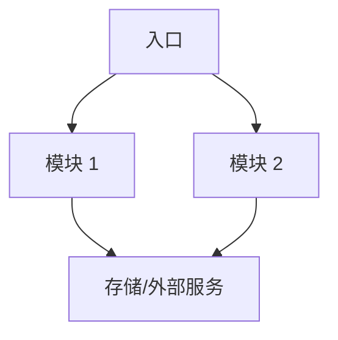

# Project Docs Sync（增强版）

完整项目文档套件生成器，一次运行输出：

| 文件 | 读者 | 职责 |
|------|------|------|
| `AGENTS.md` | AI 助手 | 项目索引、规范、入口、架构约定 |
| `README.md` | 人类开发者 | 中文首页：价值主张、安装、快速开始 |
| `CHANGELOG.md` | 开发者 / 用户 | 从 Git 历史自动生成的版本记录 |
| `docs/architecture.md` | 开发者 | Mermaid 架构图 + 数据流说明 |
| `docs/project-map.md` | 所有人 | 带注释的可视化目录树（项目地图） |

> **原则**：先读后写，内容必须可溯源。每条声明都要能在代码或配置中找到依据。

---

## Step 0：定位项目根目录 & 检测初始化命令

```bash
_ROOT=$(git rev-parse --show-toplevel 2>/dev/null || pwd)
echo "PROJECT_ROOT: $_ROOT"
```

检测项目级 init 命令（用于引导 AGENTS.md）：

```bash
_INIT_CMD=""
for _candidate in \
    "$_ROOT/.agents/commands/init.md" \
    "$_ROOT/commands/init.md" \
    "$_ROOT/.claude/commands/init.md"; do
  if [ -f "$_candidate" ]; then
    _INIT_CMD="$_candidate"
    echo "INIT_COMMAND_FOUND: $_INIT_CMD"
    break
  fi
done
[ -z "$_INIT_CMD" ] && echo "INIT_COMMAND_FOUND: none"
```

检测现有文档状态：

```bash
_HAS_AGENTS=$([ -f "$_ROOT/AGENTS.md" ]    && echo "yes" || echo "no")
_HAS_README=$([ -f "$_ROOT/README.md" ]    && echo "yes" || echo "no")
_HAS_CHANGELOG=$([ -f "$_ROOT/CHANGELOG.md" ] && echo "yes" || echo "no")
_HAS_DOCS=$([ -d "$_ROOT/docs" ]           && echo "yes" || echo "no")
echo "HAS_AGENTS_MD:   $_HAS_AGENTS"
echo "HAS_README_MD:   $_HAS_README"
echo "HAS_CHANGELOG:   $_HAS_CHANGELOG"
echo "HAS_DOCS_DIR:    $_HAS_DOCS"
```

检测 Git tag 状态（用于 CHANGELOG）：

```bash
# 仅供参考 — 输出不赋值给变量，Step 5 会重新读取
git tag --sort=-version:refname | head -5
git log --oneline -20
```

---

## Step 1：处理 init 命令（如果存在）

如果 `INIT_COMMAND_FOUND` 不是 `none` 且 `HAS_AGENTS_MD` 是 `no`：

读取 init 命令文件，按其指示引导创建 `AGENTS.md`。
执行后验证 `AGENTS.md` 是否存在于项目根目录。
若存在，输出 `AGENTS_MD_BOOTSTRAPPED: yes`，进入 Step 3（更新/丰富），跳过 Step 3 的创建逻辑。
若失败，回退到 Step 3 从零生成。

---

## Step 2：扫描项目结构

**不得省略此步骤**——文档质量与对代码的理解深度直接挂钩。

### 2a. 文件清单

```bash
find "$_ROOT" -type f \
  ! -path "*/.git/*" \
  ! -path "*/node_modules/*" \
  ! -path "*/.venv/*" \
  ! -path "*/__pycache__/*" \
  ! -path "*/dist/*" \
  ! -path "*/build/*" \
  ! -path "*/.next/*" \
  ! -path "*/.idea/*" \
  ! -path "*/vendor/*" \
  | sort | head -300
```

### 2b. 读取项目元数据文件

使用 Read 工具（非 bash）读取以下所有存在的文件：

- `package.json` / `pyproject.toml` / `pom.xml` / `build.gradle` / `Cargo.toml` / `go.mod`
- `requirements.txt` / `setup.py` / `setup.cfg`
- `.env.example` / `config.yaml` / `config.example.yml`
- 已有 `README.md`（保留有效内容）
- 已有 `AGENTS.md`（保留 Agent 专属规则）
- `CLAUDE.md` / `CONTRIBUTING.md` / `CHANGELOG.md`
- 主入口文件：`main.py`、`app.py`、`index.ts`、`index.js`、`main.go`、`Main.java`、`src/main.rs`、`cmd/main.go`

### 2c. 架构推断

从文件清单中识别：

```
LANGUAGE:        [主要语言]
FRAMEWORK:       [框架/库]
PROJECT_TYPE:    [web-app / cli-tool / library / service / monorepo / data-pipeline / other]
ENTRY_POINTS:    [主入口文件或命令]
KEY_DIRS:        [src/ lib/ cmd/ services/ 等，每个附一行用途说明]
TEST_FRAMEWORK:  [jest / pytest / go test 等]
BUILD_TOOL:      [npm / cargo / gradle / make 等]
PACKAGE_MANAGER: [npm / pip / cargo / go 等]
IS_MONOREPO:     [yes / no]
```

### 2d. 业务目的提炼

从代码和配置中回答：
- 这个项目解决什么问题？
- 目标用户 / 调用方是谁？
- 主要功能和能力有哪些？
- 不做什么（边界）？
- 与同类方案相比有何差异点？

---

## Step 3：生成 AGENTS.md

`AGENTS.md` 供 AI 助手读取。目标：让 Agent 在不读每一个文件的情况下有效工作。

**已有文件**：先读取，保留现有规则和 Agent 专属章节，更新过时的结构/入口信息。
**无文件**：按下方模板创建。

### AGENTS.md 模板

````markdown
# AGENTS.md — 项目索引

> 由 robot-aiot-docs-sync 自动生成。项目专属规则请手动维护。

## 项目概览

**名称：** <来自 package.json / pyproject.toml / 目录名>
**类型：** <PROJECT_TYPE>
**语言：** <LANGUAGE>
**框架：** <FRAMEWORK>

<一段话说明：项目做什么、谁使用、解决什么问题。>

## 仓库结构

```
<关键目录和文件，每条附一行说明>
```

## 入口点

| 命令 / 文件 | 用途 |
|---|---|
| `<入口>` | <用途> |

## 开发环境搭建

```bash
# 安装依赖
<install command>

# 本地运行
<dev/run command>

# 运行测试
<test command>

# 构建
<build command>
```

## 关键规范

- <从代码库中观察到的编码规范>
- <命名规则>
- <文件组织规则>

## 架构说明

<主要组件如何协作。数据流。代码中可见的关键设计决策。>

## Agent 工作指引

<!-- AI 助手在此项目中工作时遵循的规则 -->

- 修改前先读取 `<主入口文件>` 了解当前结构。
- 任何改动后运行 `<test command>`。
- 保持现有代码风格：<观察到的风格说明>。
- <来自现有 AGENTS.md 的项目专属规则>
````

写入 `$_ROOT/AGENTS.md`。

---

## Step 4：生成中文 README.md

`README.md` 面向人类：开发者、用户、贡献者。以中文为主，技术名词保留英文。

### README 核心原则

1. **首屏 30 秒价值判断**：首句价值主张 + 适合谁用 + 最短安装方式，缺一不可。
2. **内容可溯源**：真实命令、真实路径、真实示例，不写空泛宣传语（禁用"强大/优雅/现代化"等空词）。
3. **统一入口**：官网、文档、Issue、下载方式收敛到一个正式入口，减少用户决策成本。
4. **社交证明**：在不堆砌数据的前提下，展示 star、更新时间或代表性案例。

**已有 README.md**：先读取，保留准确内容，使用 Edit 工具更新过时章节（**不得用 Write 整体覆盖**）。
**无 README.md**：按下方模板创建。

### README.md 模板

````markdown
# <项目名称>

> <一句话价值主张：这东西解决什么问题，避免空词>

[](link) [](link) [](link)

## ✨ 项目亮点

- **亮点 1**：解决什么痛点
- **亮点 2**：与同类方案相比优势是什么
- **亮点 3**：适合谁使用

## 📦 安装

```bash
<最短可复制的安装命令>
```

## 🚀 快速开始

```bash
<最小可运行示例>
```

## 🧭 使用示例

<主要使用场景示例，覆盖 2-3 个典型用例。>

## 📁 项目结构

<引用 docs/project-map.md 或内联简版目录树>

## ❓ 适用场景

- 场景 1
- 场景 2
- 场景 3

## ⚙️ 配置

| 选项 | 默认值 | 说明 |
|---|---|---|
| `<key>` | `<default>` | <说明> |

## 🛠️ 开发

```bash
# 克隆并安装
<setup commands>

# 运行测试
<test command>

# 构建
<build command>
```

## 🤝 贡献

<简短贡献指南或链接到 CONTRIBUTING.md>

## 📝 License

<License 类型> — 详见 [LICENSE](LICENSE)
````

### README 自检清单

完成后验证：
- ☐ 首句是否说明了项目解决的问题？
- ☐ 是否给出最短可运行示例？
- ☐ 是否覆盖安装、使用、贡献、License？
- ☐ 是否避免了 AI 腔和空泛营销语？
- ☐ 命令是否可直接复制执行？
- ☐ 如果信息不足，是否标注了"待补充"而非编造？

写入 `$_ROOT/README.md`。

---

## Step 5：生成 CHANGELOG.md

从 Git 历史自动生成版本记录，遵循 Keep a Changelog 格式和 Semantic Versioning。

### 5a. 获取 Git 历史

```bash
# 获取最新 tag
git describe --tags --abbrev=0 2>/dev/null || echo "NO_TAG"

# 从上个 tag 到 HEAD 的提交
_LAST_TAG=$(git describe --tags --abbrev=0 2>/dev/null)
if [ -n "$_LAST_TAG" ]; then
  git log --oneline --no-merges "${_LAST_TAG}..HEAD"
else
  # 无 tag 时获取全部历史（最多 100 条）
  git log --oneline --no-merges -100
fi
```

### 5b. 提交分类（Conventional Commits）

| 分类 | Type 标识 | 图标 |
|------|----------|------|
| 新功能 | `feat` | ✨ |
| Bug 修复 | `fix` | 🐛 |
| 文档 | `docs` | 📝 |
| 重构 | `refactor` | ♻️ |
| 性能优化 | `perf` | ⚡ |
| 测试 | `test` | 🧪 |
| 构建/工具 | `chore` | 🔧 |
| Breaking Changes | 含 `BREAKING CHANGE:` 或 `!` | ⚠️ |
| 安全修复 | `fix(security)` 或含 CVE | 🔒 |
| 依赖更新 | `deps` 或 `chore(deps)` | 📦 |

**不符合 Conventional Commits 的提交**：归入「其他变更」，保留原始消息。

### 5c. 版本号确定策略

遵循 Semantic Versioning（`MAJOR.MINOR.PATCH`）：

| 变更类型 | 版本变化 |
|---------|---------|
| Breaking Changes（`!` 或 `BREAKING CHANGE:`） | 主版本 +1 |
| 新功能（`feat`） | 次版本 +1 |
| Bug 修复 / 文档 / 其他 | 修订版本 +1 |

若无 tag，建议从 `v0.1.0` 开始。

### 5d. 输出格式

**已有 CHANGELOG.md**：在文件顶部追加新版本块，保留历史内容。
**无 CHANGELOG.md**：创建新文件。

```markdown
# Changelog

所有值得注意的变更都将记录在此文件。
格式基于 [Keep a Changelog](https://keepachangelog.com/zh-CN/1.0.0/)，
版本号遵循 [Semantic Versioning](https://semver.org/lang/zh-CN/)。

## [Unreleased]

### ⚠️ Breaking Changes
- <如有，必须放最前面并加粗突出>

### ✨ 新功能
- <feat 提交，关联 Issue/PR 编号>

### 🔒 安全修复
- <安全相关修复，注明 CVE 编号（如有）>

### 🐛 Bug 修复
- <fix 提交>

### ⚡ 性能优化
- <perf 提交>

### ♻️ 重构
- <refactor 提交>

### 📝 文档
- <docs 提交>

### 📦 依赖更新
- <deps 更新>

### 🔧 其他变更
- <chore 及不符合规范的提交>

## [1.0.0] - YYYY-MM-DD

<历史版本，按同样格式排列，最新版本在最前>
```

注意：
- Breaking Changes 必须放最前面
- 每条记录关联 Issue/PR 编号（格式：`(#123)`）
- 安全修复注明 CVE 编号（如有）
- 空分类整个章节省略，不留占位

写入 `$_ROOT/CHANGELOG.md`。

---

## Step 6：生成技术文档（docs/ 目录）

在 `docs/` 目录下生成两个文档：

### 6a. 项目结构地图 — `docs/project-map.md`

生成带注释的可视化目录树，帮助开发者快速理解代码库组织方式。

**规则**：
- 跳过 `node_modules`、`.git`、`vendor`、`__pycache__`、`dist`、`build`、`.next`
- 最多展示 3 层深度，避免输出过长
- 每个关键目录给出一行中文说明
- 如果是 monorepo，分别列出各 packages

````markdown
# 📂 项目结构地图

> 由 robot-aiot-docs-sync 自动生成。

## 🔧 项目信息

- **语言**：<LANGUAGE>
- **框架**：<FRAMEWORK>
- **包管理**：<PACKAGE_MANAGER>
- **项目类型**：<PROJECT_TYPE>

## 🌳 目录树

```
<project-root>/
├── src/                    # 📦 核心源码
│   ├── components/         # 🧩 UI 组件
│   ├── services/           # 🔌 业务逻辑层
│   ├── utils/              # 🔧 工具函数
│   └── index.ts            # 🚀 入口文件
├── tests/                  # 🧪 测试文件
├── docs/                   # 📖 文档
├── .github/                # 🔄 CI/CD 配置
├── package.json            # 📋 依赖管理
└── README.md               # 📝 项目说明
```

## 🗺️ 模块说明

| 目录 / 文件 | 职责 | 关键文件 |
|------------|------|----------|
| `src/` | 核心源码 | index.ts |
| `tests/` | 测试套件 | — |

## 💡 入口建议

- 🚀 **启动入口**：`<主入口文件>`
- 📖 **入门文档**：`README.md`
- ⚙️ **配置文件**：`<配置文件路径>`
- 🧪 **运行测试**：`<测试命令>`
````

### 6b. 架构与 API 文档 — `docs/architecture.md`

````markdown
# 架构说明

> 由 robot-aiot-docs-sync 自动生成。

## 系统概览

<2-3 段描述：整体架构思路、核心设计决策、主要组件职责划分。凡无法从代码确认的内容，写 `<!-- TODO: verify -->`，不编造。>

## 架构图



## 数据流

<说明数据从输入到输出的流转路径>

## 核心模块

| 模块 | 职责 | 关键接口 |
|------|------|----------|
| `<模块名>` | <职责> | `<接口签名>` |

## 依赖关系 <!-- optional -->

<说明主要外部依赖及其用途>

## 扩展点 <!-- optional -->

<如何在现有架构上添加新功能>

## 已知限制 <!-- optional -->

<当前设计的边界和约束>

## 常见问题（FAQ）

**Q: <常见问题 1>**
A: <解答>

**Q: <常见问题 2>**
A: <解答>
````

写入 `$_ROOT/docs/project-map.md` 和 `$_ROOT/docs/architecture.md`。
如果 `docs/` 目录不存在，先创建它。

---

## Step 7：输出报告

打印执行摘要：

```
=== robot-aiot-docs-sync 完成 ===

文件状态：
  AGENTS.md       [created|updated|bootstrapped-then-updated]  (<N> 章节)
  README.md       [created|updated|unchanged]  (<N> 章节更新)
  CHANGELOG.md    [created|updated|unchanged]  (<N> 条变更, 版本 <X.Y.Z>)
  docs/project-map.md    [created|updated]
  docs/architecture.md   [created|updated]

关键变更：
  - <每条重要变更一行说明>

版本号建议：<如生成了 CHANGELOG，给出建议的下一版本号>

需要人工审查：
  - <无法从代码推断的信息，建议手动补充的位置>

文件路径：
  $_ROOT/AGENTS.md
  $_ROOT/README.md
  $_ROOT/CHANGELOG.md
  $_ROOT/docs/project-map.md
  $_ROOT/docs/architecture.md
```

---

## 守则（Guardrails）

- **先读后写**：更新前始终先读取现有文件。
- **保留项目专属规则**：AGENTS.md 中已有的 `## Agent Guidelines` 或 `## Conventions` 章节视为权威，只追加不覆盖。
- **内容可溯源**：所有五个文档文件中的所有声明必须能追溯到项目中的实际文件、配置或代码模式。无法确认的内容写"TODO: 待补充"，不编造。
- **Edit 优先于 Write**：对已有内容丰富的 README.md 和 CHANGELOG.md，使用 Edit 工具精确修改，不整体覆盖。
- **init 命令优先**：若 `/init` 命令已引导生成 AGENTS.md，以其输出为基础只做追加/更新，不替换。
- **仅限文档范围**：此技能不修改源代码、配置文件或测试文件。只写入上述五个文档文件。
- **空分类省略**：CHANGELOG 中无内容的分类章节整体省略，不留空占位。
- **中文为主**：README、project-map、architecture 文档以中文撰写，技术名词（类名、函数名、命令、路径）保留英文原文。
